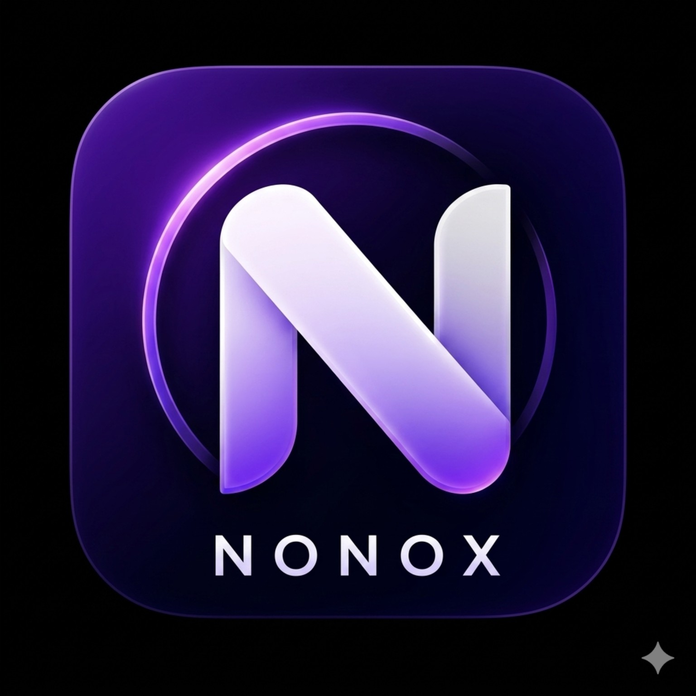
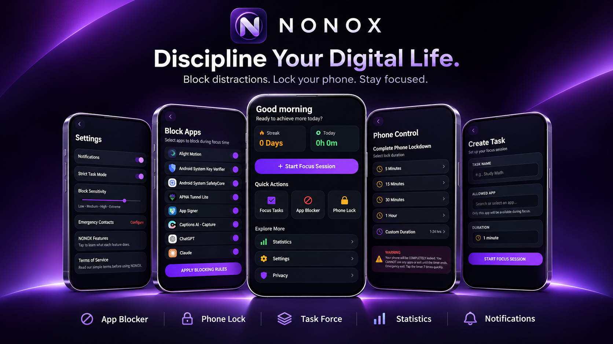
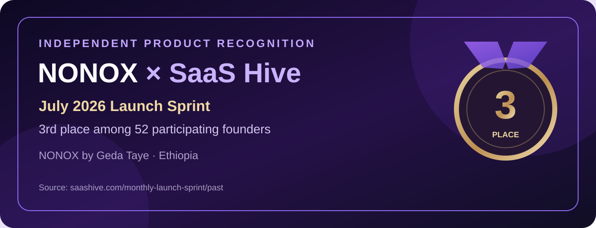
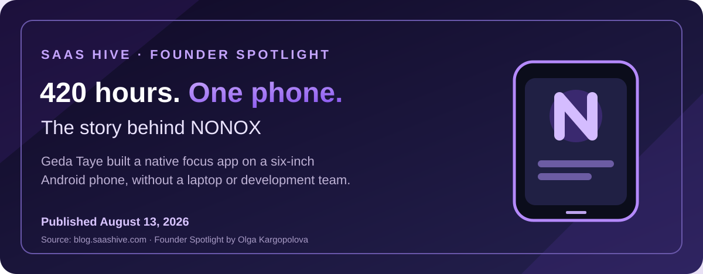
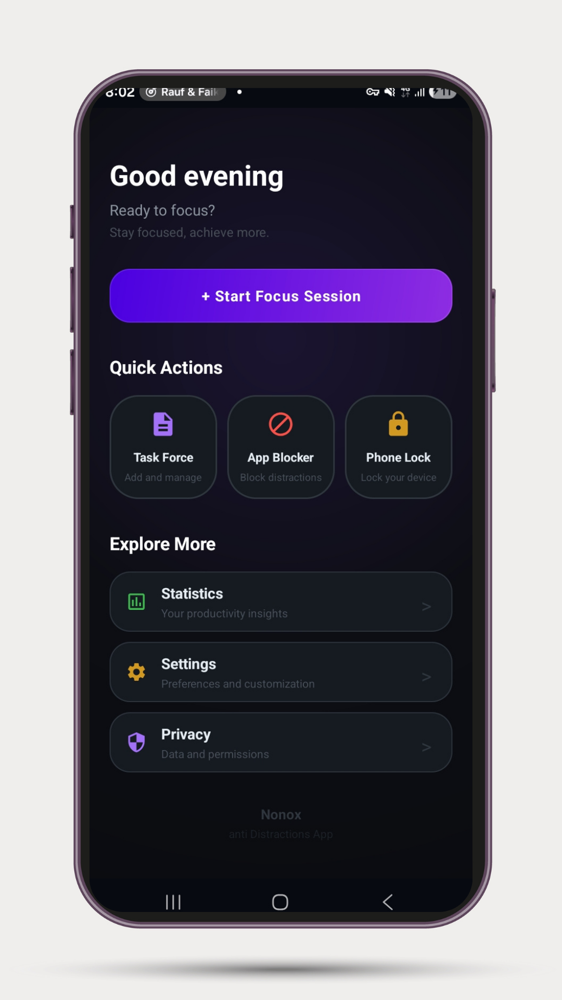
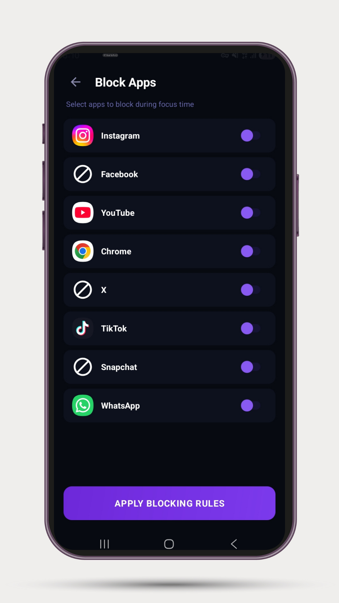
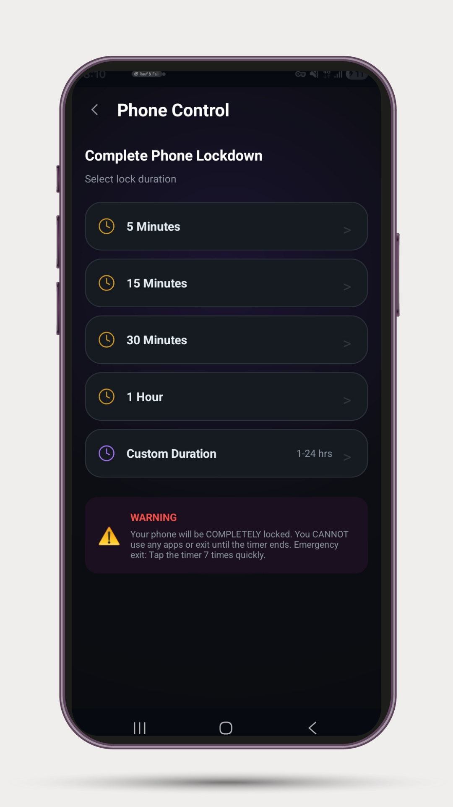
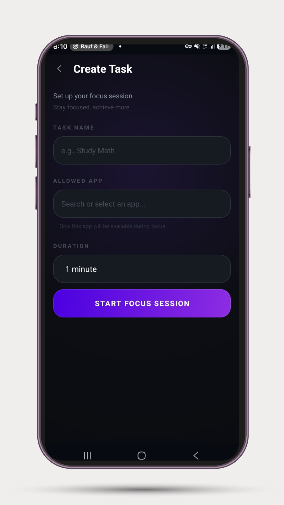
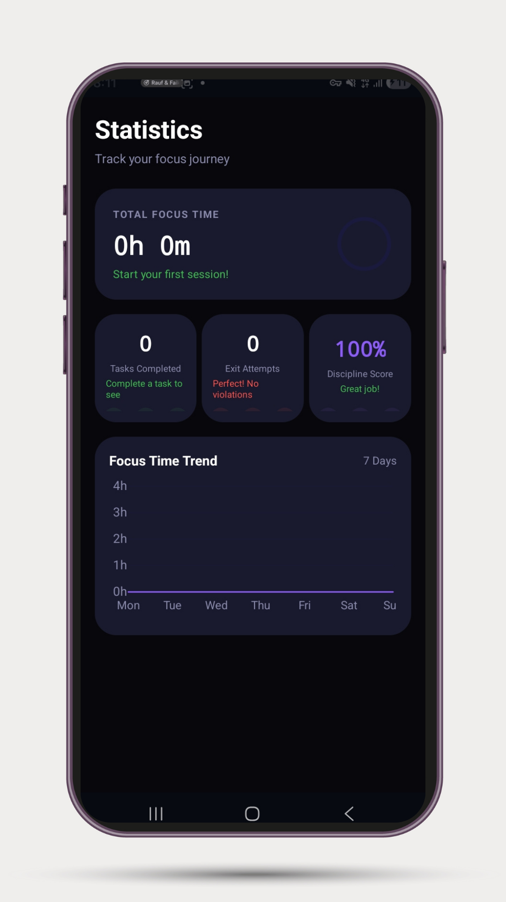
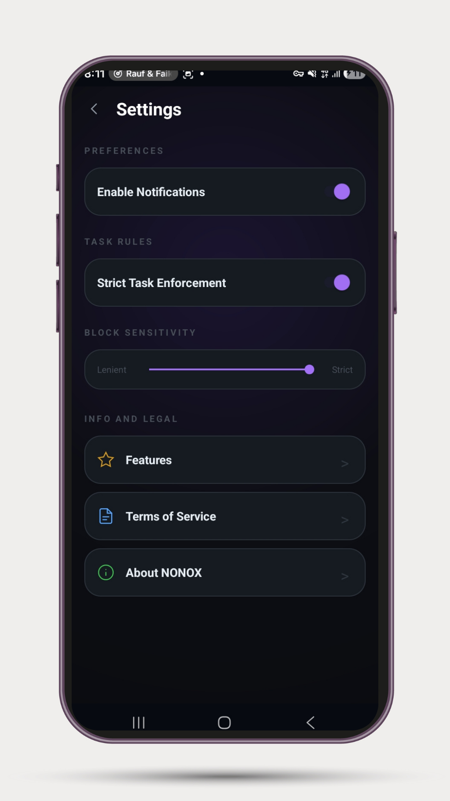

# NONOX — Focus & Discipline for Android

**Block distractions. Commit to your goals.**

**[Install NONOX](https://play.google.com/store/apps/details?id=com.nonox.app)** · **[Developer profile](https://github.com/geda21)**

---

## Make your phone work for you

**NONOX** is a native Android focus and discipline app designed to help people spend less time on distracting apps and more time on meaningful work. It offers different levels of focus control, from selected app blocking to stricter phone-lock sessions.

| Experience | Purpose |
|---|---|
| **App Blocker** | Restrict selected distracting apps while focusing. |
| **Phone Lock** | Start a strict focus session that limits device access. |
| **Task Force** | Concentrate on one permitted app or a selected set of apps. |
| **Statistics** | Track focus activity and review your progress. |
| **Session controls & notifications** | Configure restrictions and view session information. |

Some modes require Accessibility Service and Device Administrator permissions. Behavior varies by Android version, device manufacturer and enabled permissions.

## Recognition & founder coverage

### 3rd place — SaaS Hive July 2026 Launch Sprint

NONOX by **Geda Taye** placed **3rd among 52 participating founders** in SaaS Hive's **July 2026 Launch Sprint**. This placement is recorded in the platform's official past-winners archive.

**[View the official SaaS Hive winners archive](https://saashive.com/monthly-launch-sprint/past)**

### Featured founder interview — August 13, 2026

SaaS Hive published a **Founder Spotlight interview** about the journey of building NONOX entirely on a **six-inch Android smartphone**, including roughly **420 hours of coding** and the difficulties of developing without a laptop or team.

**[Read the original SaaS Hive founder interview](https://blog.saashive.com/post/coding-420-hours-on-a-6-inch-phone-in-a-room-with-flickering-electricity-to-build-a-focus-app)**

*The graphics above are original editorial illustrations summarizing independently verifiable recognition. They are not an official SaaS Hive certificate or award graphic.*

---

## Inside NONOX — Real Screenshots

All six screenshots below already existed in this repository. The original **`screenshots/` assets are preserved**.

  
  
  

  
  
  

## Official Android download

### [Get NONOX on Google Play](https://play.google.com/store/apps/details?id=com.nonox.app)

Package ID: `com.nonox.app`

Use the Play Store page for the current release, device compatibility, user-facing privacy information and installation. The previous GitHub README's v1.0.0 APK, download and Android minimum-version statements are intentionally not repeated as current release information.

## Engineering notes

- **Native Android application** written primarily in Java.
- Built and tested using an **Android smartphone**, without a traditional desktop development setup.
- Uses Android accessibility and device administration capabilities for focus restrictions.
- Handles device and session lifecycle cases, including reboot recovery logic in applicable modes.
- The developer reports **8,500+ lines of Java** and **420+ hours** invested in the project.

This GitHub repository is currently a **product showcase and screenshot gallery**; it does not include the complete buildable production source.

## Built on a phone. Published for the real world.

**Geda Taye** is a self-taught Android and web developer from Ethiopia. NONOX grew from hands-on native app development, repeated device testing and a determination to ship working software using the tools available on a smartphone.

Other projects: [JABAA Shop](https://jabashop.store) · [JLab](https://github.com/geda21/Jlab)

## Contact

[GitHub](https://github.com/geda21) · [LinkedIn](https://www.linkedin.com/in/geda-taye-a60b403ba) · [Google Play](https://play.google.com/store/apps/details?id=com.nonox.app)

---

**Rights:** NONOX is a proprietary app. The presence of screenshots and documentation in this repository does not grant a license to redistribute the app or assets.
